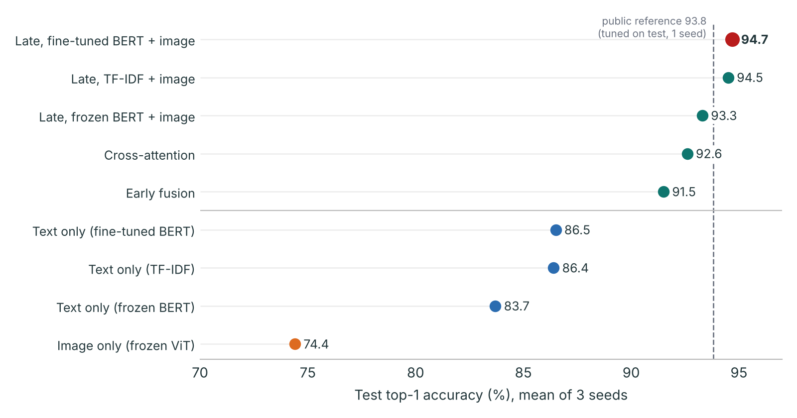
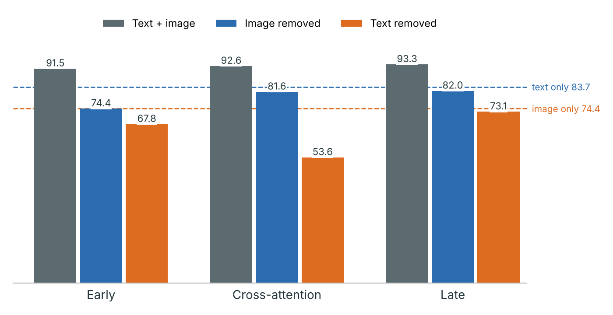

# recipe-fusion

[](https://github.com/ademasles/recipe-fusion/actions/workflows/ci.yml)
[](LICENSE)


**Which fusion should you use to recognise a dish from its photo and its web page title?**

A controlled comparison of early, cross-attention and late fusion on UPMC Food-101 (101 dishes,
90,688 image and title pairs), with unimodal baselines, three seeds per method, modality
ablations and an audit of the benchmark's train/test leak. Project 1 of the Advanced Deep
Learning course at Mines Nancy (2026).



## Findings

- **The simplest fusion wins.** A calibrated weighted sum of two unimodal experts reaches
  **94.7 %** top-1 on the test split, ahead of cross-attention (92.6 %) and early fusion
  (91.5 %) trained on the same frozen features. The public reference reports 93.8 % with
  hyperparameters chosen on the test split and a single seed.
- **Every fusion adds 5 to 8 points** over the best single modality (86.5 %).
- **Fine-tuning BERT does not beat TF-IDF** (86.5 % vs 86.4 %): titles are 7 words long and
  three in four name the dish.
- **Only late fusion degrades gracefully.** With the text removed at test time it keeps 73.1 %,
  close to the image-only model (74.4 %); cross-attention collapses to 53.6 % because it learned
  to rely on the text.
- **The benchmark leaks.** 37.7 % of test titles appear verbatim in the training set, where a
  title lookup table alone scores 92.6 %, and 5.1 % of test images are byte-identical to a
  training image. We therefore also report scores on test pairs never seen in training, and on
  titles that do not name the dish, where the image matters most (text alone 51.1 %, late fusion
  82.3 %).

## Results

Test top-1 accuracy (%), mean ± standard deviation over three seeds. *Unseen*: neither the title
nor the image occurs in the training set (61.5 % of the test split). *No dish name*: the title
does not mention the class (26.4 %).

| Method | All | Unseen | No dish name |
|---|---|---|---|
| Image only, MLP on frozen ViT-B/16 | 74.4 ± 0.1 | 75.6 ± 0.2 | 70.5 ± 0.1 |
| Text only, MLP on frozen BERT | 83.7 ± 0.1 | 79.3 ± 0.1 | 46.0 ± 0.5 |
| Text only, TF-IDF + logistic regression | 86.4 | 82.8 | 51.1 |
| Text only, fine-tuned BERT | 86.5 ± 0.3 | | |
| Early fusion (concatenation + MLP) | 91.5 ± 0.1 | | |
| Cross-attention fusion | 92.6 ± 0.2 | 91.5 ± 0.2 | 75.3 ± 0.5 |
| Late fusion, raw logit sum (frozen BERT + image) | 93.4 ± 0.1 | 91.9 ± 0.1 | 80.1 ± 0.1 |
| Late fusion, calibrated (frozen BERT + image) | 93.3 ± 0.1 | 91.9 ± 0.2 | 80.2 ± 0.4 |
| Late fusion, calibrated (TF-IDF + image) | 94.5 ± 0.0 | 93.4 ± 0.0 | 82.3 ± 0.3 |
| **Late fusion, calibrated (fine-tuned BERT + image)** | **94.7 ± 0.0** | | |

Empty cells were not computed for that subset. TF-IDF is deterministic. Ablations and the full
breakdown are in [docs/results.md](docs/results.md); the defence slides are in
[docs/slides/](docs/slides/).



## Method

- **Encoders.** BERT-base-uncased on cleaned titles (HTML entities and byte escapes decoded,
  40 tokens) and ViT-B/16 SWAG at 384 px. Both are frozen and their features cached once; BERT is
  also fine-tuned end to end as a text reference.
- **Fusions.** *Early*: concatenated pooled features into an MLP. *Cross-attention*: the 40 title
  tokens and the 8×8 image patch grid attend to each other in both directions, then pooled into
  the same head. *Late*: $\alpha \log p_\text{image} + (1-\alpha) \log p_\text{text}$ with
  temperatures and $\alpha$ chosen on validation; nothing else is trained.
- **Protocol.** A stratified 10 % validation split drawn once from the training set
  ([splits/val_ids.txt](splits/val_ids.txt)); AdamW, batch 256, early stopping on validation
  loss; the same 3×2 learning-rate × weight-decay grid for every head on cached features, chosen
  on validation with seed 0, then three seeds. Every method writes logits in one format and is scored by a single
  script ([evaluate.py](src/recipe_fusion/evaluate.py)). The test split was scored once, and
  nothing was tuned after.
- **Ablations.** At test time one modality is replaced by its training mean, or shuffled across
  examples; the late fusion weights stay frozen.

**Limitations.** The selected learning rates sit at an edge of their grid (the lowest for every
head on cached features, the highest for BERT fine-tuning) and were not widened after the test
run; the ViT is never fine-tuned; the validation split shares the leak of the test split.

## Reproducing

Requirements: Linux, macOS on Apple silicon or WSL2, with git, [uv](https://docs.astral.sh/uv/)
and [just](https://just.systems). An NVIDIA GPU is needed for feature extraction and BERT
fine-tuning (an 8 GB RTX 4070 was used: about 2.5 min per fine-tuning epoch); every other model
trains from the cached features.

```bash
just sync                   # create .venv from uv.lock
just check                  # ruff + basedpyright + pytest
just download               # UPMC Food-101 from Kaggle (8.3 GB)
just check-images           # decode every image once
just extract-text           # BERT features (pooled + tokens)
just extract-image          # ViT-B/16 features (pooled + 8x8 grid)
just make-subsets           # leak audit and evaluation subsets (committed in splits/)

just train-image-mlp        # image baseline
just train-text-mlp         # text baselines
just train-tfidf
just train-bert-finetune    # fine-tuned BERT reference (GPU)
just train-early-fusion     # fusions; each writes its test-time ablations
just train-cross-attention
just train-late-fusion
just train-late-fusion text.method=tfidf_logreg name=late_calibrated_tfidf sum_name=null
just train-late-fusion text.method=text_bert_ft name=late_calibrated_ft sum_name=null

just evaluate split=test    # outputs/results/test_summary.csv
just plot-results           # the two figures above
```

[notebooks/live_demo.ipynb](notebooks/live_demo.ipynb) runs the best model live on a test pair
(register the kernel once with `just kernel`).

The validation split and the evaluation subsets are committed, so `make-split` and
`make-subsets` only need to be rerun to check them. `just evaluate` alone scores the validation
split, which is what every choice was made on.

<details>
<summary>Installing uv and just</summary>

Once per machine, no admin rights needed. Python itself is downloaded by uv, at the version
pinned in `.python-version`.

```bash
curl -LsSf https://astral.sh/uv/install.sh | sh   # uv, macOS and Linux
uv tool install rust-just                         # just, distributed through uv
```

</details>

## Layout

| Path | Contents |
|---|---|
| `src/recipe_fusion/data/` | Dataset index, download, title cleaning, validation split, leak audit |
| `src/recipe_fusion/features/` | Image integrity check, BERT and ViT extraction, feature cache |
| `src/recipe_fusion/models/` | Baselines, fine-tuned BERT, early, cross-attention and late fusion |
| `src/recipe_fusion/training.py` | Shared training loop, search and early stopping |
| `src/recipe_fusion/evaluate.py` | The single evaluation script |
| `src/recipe_fusion/demo.py`, `notebooks/` | Live prediction of the best model on one pair |
| `configs/` | Hydra configuration, one file per model under `configs/train/` |
| `splits/` | Validation ids and evaluation subsets |
| `scripts/` | GPU check, README figures |
| `docs/` | Results, figures, slides, initial plan |
| `tests/` | pytest, CPU only |
| `data/`, `outputs/` | Data and experiment outputs, ignored by git |

## Data

- Source: the Kaggle copy `gianmarco96/upmcfood101`, version 1, downloaded with `kagglehub`
  without an account, into `data/upmc-food101/` (or `F101_DATA_DIR`).
- `texts/{train,test}_titles.csv`: no header, three columns (image file, title, class). Images
  in `images/{train,test}/<class>/<file>.jpg`.
- 67,972 training pairs, split once into 61,177 for training and 6,795 for validation, and
  22,716 test pairs.

## Team

[ademasles](https://github.com/ademasles): data, evaluation, leak audit, feature cache,
cross-attention. [Argodm](https://github.com/Argodm): text baselines, early fusion, BERT
fine-tuning. [OriGiNaLGet9](https://github.com/OriGiNaLGet9): image baseline, late fusion.

## Licences

The code is released under the MIT licence (see [LICENSE](LICENSE)).

The Kaggle copy of UPMC Food-101 states no licence. The images and titles were collected from
the web by the dataset authors: research and teaching use only, no redistribution. Cite Wang,
Kumar, Thome, Cord and Precioso (2015), *Recipe recognition with large multimodal food dataset*,
ICME Workshops.
